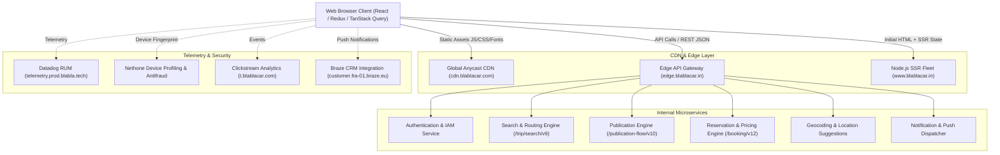

# BlaBlaCar India — Backend Architecture & Infrastructure Engineering

This document outlines the distributed backend systems, API gateway routing, authentication lifecycle, state hydration, and telemetry pipelines discovered across **BlaBlaCar India** (`https://www.blablacar.in/`).

---

## 1. High-Level Architectural Topology



---

## 2. The Edge Gateway Pattern (`edge.blablacar.in`)

BlaBlaCar decouples its frontend SSR servers from internal business logic by channeling all client traffic through a dedicated edge gateway:

1. **Protocol & Host**: `https://edge.blablacar.in` (HTTP/2.0).
2. **CORS & Security Policies**:
   * `access-control-allow-origin: https://www.blablacar.in`
   * `access-control-allow-credentials: true`
   * `strict-transport-security: max-age=31536000; includeSubDomains`
3. **Internal Gateway Headers**:
   * `x-internal-token`: Cryptographically signed gateway token guaranteeing request passed through the edge.
   * `x-client-platform: WEB`: Identifies client device surface.
   * `x-locale: en_IN`: Enforces Indian localization and pricing rules.
   * `x-currency: INR`: Standardizes currency presentation to Indian Rupees.

---

## 3. Session & Authentication Lifecycle

Extracted directly from `window["__INFRASTRUCTURE__authentication"]`:

```json
{
  "authentication": {
    "type": "Authenticated",
    "userId": "21490368-dacb-4e96-bcb9-c15a2cf850dd",
    "authenticationToken": {
      "type": "Valid",
      "token": {
        "type": "Token",
        "accessToken": "a97c431a-ab17-47cc-8b64-a6ec37891c26",
        "refreshToken": "0045eeb9-abfa-4647-b6d0-38e6448eef0c"
      }
    }
  }
}
```

* **Access Token**: Short-lived Bearer token sent in `Authorization: Bearer <accessToken>` headers.
* **Refresh Token**: Opaque string used to acquire new access tokens without requiring user re-authentication.
* **Cookie Scope**: Issued against domain `.blablacar.in` with `Secure; HttpOnly; SameSite=Lax`.
* **State Machine Changes**: Tracks automated token renewal events on both client and SSR runtime.

---

## 4. Frontend Data Layer & State Hydration

BlaBlaCar combines **Redux Toolkit** and **TanStack Query (React Query)**:

1. **Server State (TanStack Query)**:
   * Handles asynchronous server queries (Trip results, suggestions, booking details).
   * Hydrates from SSR through `dehydratedTanstackQueryState`.
   * Deduplicates queries and background refetches on window focus.
2. **Client State (Redux Toolkit)**:
   * Slices: `requests`, `entities`, `settings`, `publish`, `session`, `errors`, `snackbar`, `views`.
   * Manages local UI interactions (Publish form wizard drafts, active modal states, notification drawer open/close).

---

## 5. Telemetry, Performance & Fraud Prevention

1. **Real User Monitoring (RUM)**:
   * Host: `telemetry.prod.blabla.tech/v1/metrics`.
   * Captures Core Web Vitals (Largest Contentful Paint `LCP`, First Input Delay `FID`, Cumulative Layout Shift `CLS`), hydration timings, and resource error rates.
2. **Device Profiling & Anti-Fraud**:
   * Uses **Nethone** device fingerprinting to detect automated scrapers, multiple account abuse, and fake ride postings.
3. **Behavioral Analytics**:
   * Dispatches batched clickstream events to `t.blablacar.com/v2/c` with search UUID tracking conversion funnels from origin to booking confirmation.
