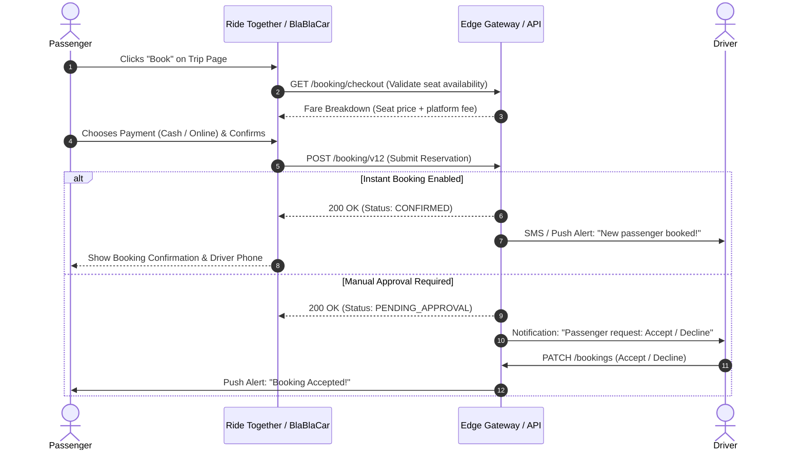

# BlaBlaCar India — Complete Feature Matrix & Functional Specifications

This document outlines the complete functional feature set, business logic, constraints, and operational flows identified across **BlaBlaCar India** (`https://www.blablacar.in/`).

---

## 1. Feature Overview Matrix

| # | Feature Area | Description | Implementation Endpoint |
| :- | :--- | :--- | :--- |
| **01** | **Location Autocomplete** | Geocoding suggestions with user history & landmark icons | `GET /location/suggestions` |
| **02** | **Trip Discovery & Search** | Origin, destination, date & seat filter search engine | `GET /trip/search/v9` |
| **03** | **Search Results Filtering** | Time slots (Morning, Afternoon, Evening), price sort, instant booking | Client-side & query parameters |
| **04** | **Itinerary Timelines** | Full route visualization with departure, waypoints, & drop-offs | `GET /trip/details/v3` |
| **05** | **Seat Reservation & Booking** | Instant booking or driver approval with seat locks | `POST /booking/v12` |
| **06** | **Fare Calculation Engine** | Base driver price + platform service fee calculation | SSR `/booking/checkout` |
| **07** | **Multi-Step Ride Publishing** | Driver wizard for route, stopovers, capacity, & price | `POST /experience/publication-flow/v10` |
| **08** | **Driver Reputation & Badges** | Star rating, completed rides, ID/phone verifications | `GET /experience/driver-grade` |
| **09** | **Vehicle & Comfort Guidelines** | "Max 2 in the back", AC, luggage size, smoking, pets | Ride & Publish state |
| **10** | **CO₂ Environmental Metrics** | Kilograms of carbon offset compared to single-occupant cars | Itinerary metadata calculations |
| **11** | **Notification Center** | Real-time unread notification badge & alert stream | `GET /notification/count/v4` |

---

## 2. In-Depth Feature Specifications

### 2.1 Location Autocomplete & Geocoding
* **Recent History First**: If query is empty, displays user's previous 4 search destinations with a clock icon (`user_history: true`).
* **Live Search**: Debounces keystrokes (200ms) and queries `/location/suggestions`.
* **Structured Hierarchy**: Returns `main_text` (landmark/neighborhood) and `secondary_text` (city, state, country) with latitude and longitude.
* **Transit Station Highlights**: Recognizes bus stands (e.g., *Majestic Bus Station*), metro stations, toll plazas, and airports.

### 2.2 Search Filtering & Sorting
* **Departure Time Windows**:
  * Before 06:00 (Early Morning)
  * 06:00 – 12:00 (Morning)
  * 12:00 – 18:00 (Afternoon)
  * After 18:00 (Evening / Night)
* **Trust & Comfort Toggles**:
  * `⚡ Instant Booking`: Filter rides that don't require waiting for driver approval.
  * `Max 2 in the back`: Guarantees the middle rear seat remains empty for passenger comfort.
  * `Verified Driver`: Only show drivers with government ID verification.
* **Sorting Modes**:
  * Earliest departure time (Default)
  * Lowest price first
  * Closest to departure point
  * Shortest ride duration

### 2.3 Ride Publishing Wizard (Driver Flow)
The publication wizard runs as a state-machine driven by `POST /experience/publication-flow/v10`:
1. **Departure (`DEPARTURE`)**: Exact pickup address or city center.
2. **Arrival (`ARRIVAL`)**: Destination city and preferred drop-off area.
3. **Stopovers (`STOPOVERS`)**: Recommended highway waypoints to maximize passenger occupancy.
4. **Schedule (`DATE_TIME`)**: Date picker and 24-hour time picker.
5. **Capacity (`CAPACITY`)**: Number of available seats (1 to 8). Includes the `two_max_back` toggle.
6. **Pricing (`PRICE`)**: Recommends a fair price per seat based on distance (typically ₹2.0–₹2.8 per km). Green color indicates an optimal price, while amber warns if price exceeds cost-sharing regulations.
7. **Vehicle (`CAR`)**: Make, model, color, and license plate.

### 2.4 Booking & Reservation Life Cycle

### 2.5 Driver Trust, Grades & Badges
* **Ambassador Level**: Drivers who have hosted >25 rides, have an average rating $\ge 4.7$, and have verified their government-issued ID.
* **Verification Badges**:
  * Blue shield: Government ID checked.
  * Green check: Phone number verified.
  * Envelope check: Email verified.
* **Passenger Reviews**: Ratings from 1 to 5 stars with written feedback displayed on the driver profile.

### 2.6 Sustainability & Carbon Savings
* Formula: $\text{CO}_2\text{ saved (kg)} = \text{Distance (km)} \times 0.120\text{ kg/km} \times \frac{\text{Seats Booked}}{\text{Vehicle Capacity}}$
* Displays an eco-badge on search results: e.g. *"Saves ~14 kg CO₂ compared to solo travel"*.
