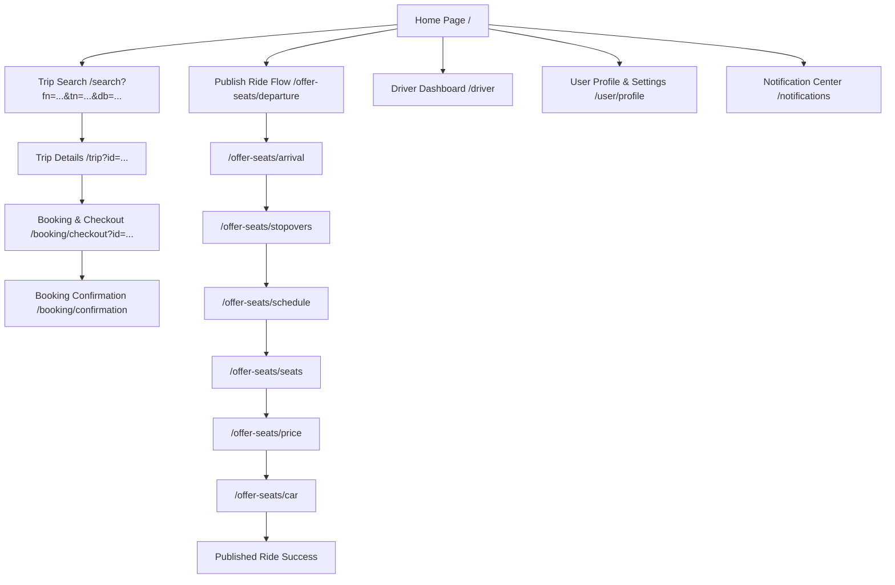

# BlaBlaCar India — DOM Structure & Architecture Mapping

This document details the frontend page structure, semantic DOM layouts, routing hierarchy, and SSR hydration mechanisms discovered on **BlaBlaCar India** (`https://www.blablacar.in/`).

---

## 1. Application URL & Routing Hierarchy



### Route Table
| Path | Description | Rendering Strategy | Primary Data Sources |
| :--- | :--- | :--- | :--- |
| `/` | Landing page & hero search | Server-Side Rendered (SSR) | Marketing CMS, cached popular routes |
| `/search` | Live trip search results | Hybrid SSR + Client Hydration | `/trip/search/v9`, TanStack Query cache |
| `/trip` | Comprehensive itinerary & driver profile | Dynamic SSR | `frontLoadFetchedData`, `/trip/details/v3` |
| `/booking/checkout` | Reservation review & payment options | Client-side with SSR envelope | `/booking/v12` |
| `/offer-seats/*` | Driver ride publishing wizard | Multi-step client state machine | `/experience/publication-flow/v10` |
| `/driver` | Host management dashboard | Authenticated client view | `/api/rides`, Driver booking moderation |

---

## 2. DOM Page Layout & Semantic Structure

BlaBlaCar implements a clean, accessible HTML5 semantic layout:

```html
<!DOCTYPE html>
<html lang="en-IN" dir="ltr">
  <head>
    <meta charset="utf-8" />
    <meta name="viewport" content="width=device-width, initial-scale=1, shrink-to-fit=no" />
    <title>Share Rides, Save Money with Carpool | BlaBlaCar</title>
    <!-- CSS & Font Preloads -->
    <link rel="preload" href=".../GT-Eesti-Pro-Display-Regular-1.woff2" as="font" type="font/woff2" crossorigin />
    <link rel="stylesheet" href=".../index.35bacfc6957d2455.css" />
  </head>
  <body>
    <!-- 1. Header Navigation Bar -->
    <header role="banner" class="kirk-header">
      <div class="kirk-header-container">
        <!-- Logo -->
        <a href="/" aria-label="BlaBlaCar Homepage" class="kirk-logo-link">...</a>
        
        <!-- Action Items -->
        <nav role="navigation" class="kirk-nav">
          <a href="/search" class="kirk-search-link">Search</a>
          <a href="/offer-seats/departure" class="kirk-publish-btn">Publish a ride</a>
          <button class="kirk-user-menu-btn" aria-expanded="false">
            <span class="avatar-circle">...</span>
          </button>
        </nav>
      </div>
    </header>

    <!-- 2. Main Page Content -->
    <main id="main-content" role="main" class="kirk-main">
      <!-- Search Banner Container -->
      <section class="hero-search-section">
        <h1 class="hero-title">Your pick of rides at low prices</h1>
        <div class="floating-search-bar" role="search">
          <!-- Departure / Arrival / Date / Seats Inputs -->
        </div>
      </section>

      <!-- Results / Content Container -->
      <section class="content-container">
        <!-- Trip Cards Grid or Marketing Pillars -->
      </section>
    </main>

    <!-- 3. Global Footer -->
    <footer role="contentinfo" class="kirk-footer">
      <div class="footer-columns">
        <div class="col">Top carpool routes</div>
        <div class="col">About BlaBlaCar</div>
        <div class="col">Safety & Help</div>
      </div>
      <div class="footer-bottom">
        <span>© 2026 BlaBlaCar</span>
      </div>
    </footer>

    <!-- 4. Client Hydration Data Envelopes -->
    <script>window["__INFRASTRUCTURE__cache"] = { ... };</script>
    <script>window["__INFRASTRUCTURE__authentication"] = { ... };</script>
    <script>window["__INFRASTRUCTURE__render"] = { ... };</script>
  </body>
</html>
```

---

## 3. Grid & Breakpoint Specifications

Extracted from production CSS (`index.35bacfc6957d2455.css`):

| Viewport Name | Media Query Range | Container Max Width | Horizontal Padding | Columns |
| :--- | :--- | :--- | :--- | :--- |
| **Mobile** | `< 768px` | `100%` (fluid) | `16px` | 1 |
| **Tablet** | `768px – 1023px` | `736px` | `24px` | 1 / 2 |
| **Desktop** | `1024px – 1319px` | `1016px` (`--j43jruw`) | `32px` | 2 (Sidebar + Results) |
| **Wide Desktop**| `>= 1320px` | `1320px` (`--j43jrux`) | `48px` | 2 (Centered Content) |

---

## 4. SSR State Hydration Pipeline (`__INFRASTRUCTURE__`)

BlaBlaCar hydrates the browser DOM from Node.js SSR through dedicated global window state objects:

1. **`window["__INFRASTRUCTURE__cache"]`**:
   * Pre-hydrated API query results (such as `/trip/search/v9`).
   * Eliminates flash of unstyled/empty content (FOUC) and second network requests upon initial load.

2. **`window["__INFRASTRUCTURE__authentication"]`**:
   * Carries authenticated state, user ID (`21490368-dacb-...`), access token, and refresh token lifecycle.

3. **`window["__INFRASTRUCTURE__render"]`**:
   * Stores `frontLoadFetchedData` and `dehydratedTanstackQueryState`.
   * Directly consumed by TanStack Query `Hydrate` boundary.

4. **`window["__INFRASTRUCTURE__redux"]`**:
   * Manages global slices: `requests`, `entities`, `settings`, `publish`, `session`, `errors`, `snackbar`, and `views`.
